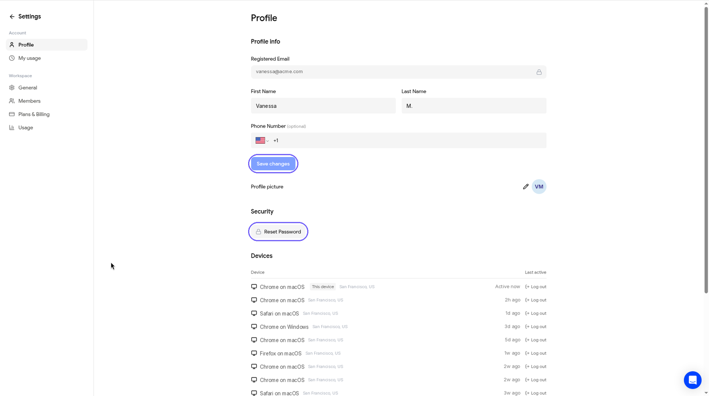
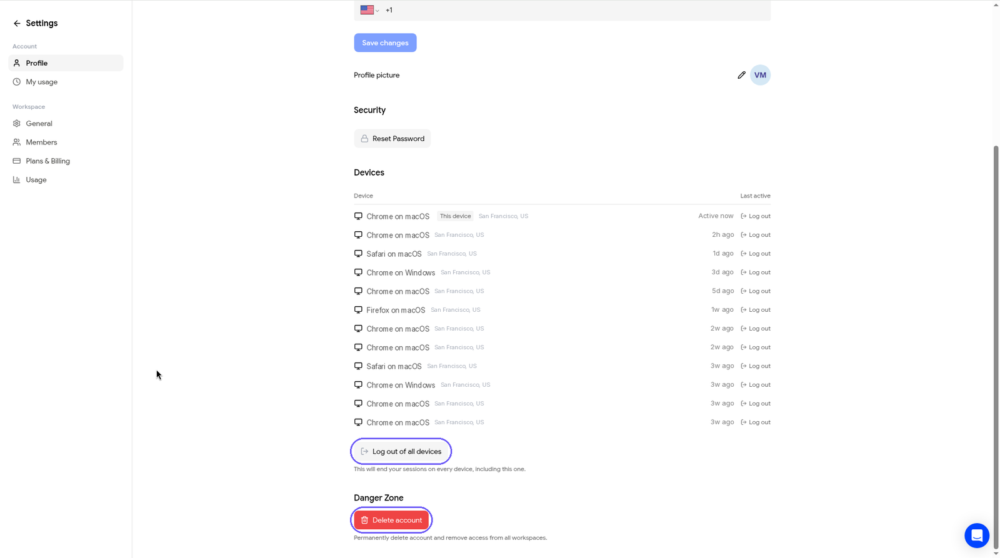

Manage your personal account details, password and signed-in devices.

<Frame caption="The Profile page, where you edit your name and reset your password.">
  
</Frame>

## Update your profile

1. Open the workspace menu, then select **Settings**.
2. Under **Account**, select **Profile**.
3. Change your first name, last name or profile picture.
4. Select **Save changes**.

Your email shows here but can't be changed.

## Reset your password

Select **Reset Password**. Velo emails you a reset link.

## Sign out of devices

The **Devices** table lists every place you're signed in, with the device, IP address and last active time.

- **Log out:** End one session.
- **Log out of all devices:** End every session, including this one.

<Frame caption="The Devices table, Log out of all devices, and the Danger Zone.">
  
</Frame>

## Delete your account

1. In **Profile**, go to **Danger Zone**.
2. Select **Delete account** and confirm.

<Warning>
Deleting your account is **permanent** and removes you from every workspace. Download any videos you need first. If you're the last owner, ownership passes to the earliest-joined admin.
</Warning>

## FAQs

**Can I change my email?**

No. Your email can't be changed from Profile.

**Will signing out of a device affect my videos?**

No. It only ends that browser session.

**Can I sign up again after deleting my account?**

Yes. Deleting your account frees your email for a new sign-up.
