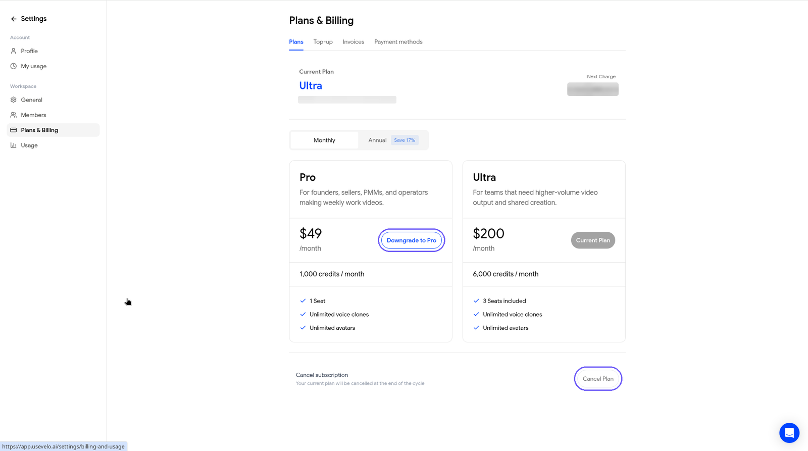
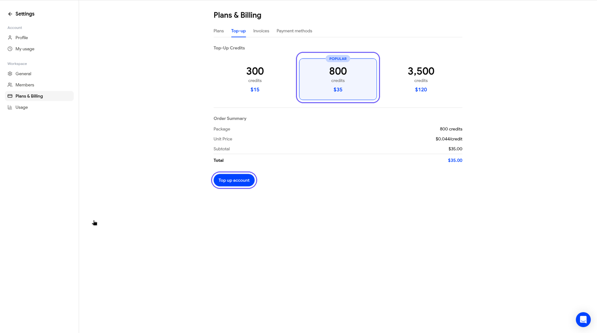
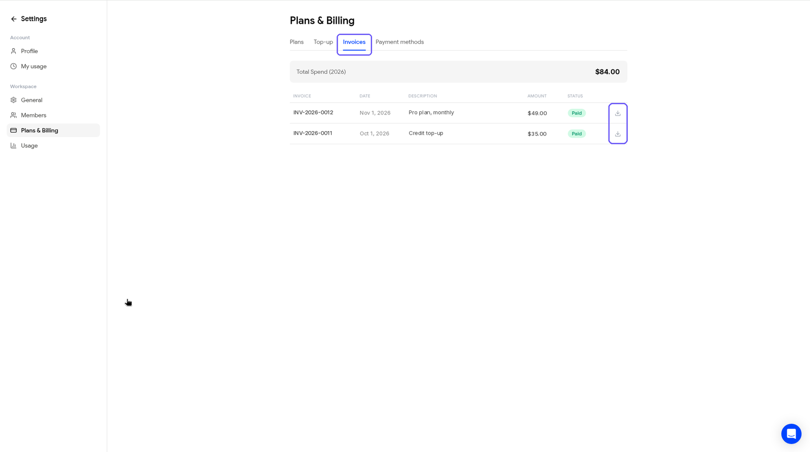
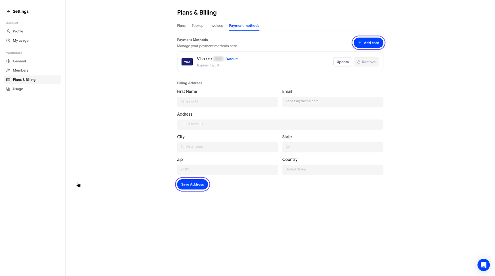

**Plans:** Pro, Ultra · **Role:** Owner · **Uses credits:** No

Buy more credits when you need them, and manage invoices and payment for your workspace.

<Frame caption="The Plans tab in Plans and Billing, with Pro and Ultra.">
  
</Frame>

## Before you start

- Your workspace is on Pro or Ultra. Free workspaces can't buy top-ups.
- You're the workspace owner. Only the owner can buy top-ups and manage billing.

## Buy a top-up

1. Open the workspace menu, then select **Settings**.
2. Under **Workspace**, select **Plans & Billing**.
3. Open the **Top-up** tab.
4. Select a pack.
5. Check the order summary, then confirm the purchase.

What happens next: the credits are added to your workspace's balance right away.

<Frame caption="The Top-up tab with a pack selected and the order summary.">
  
</Frame>

## Top-up details

- **One balance:** Top-up credits join your workspace's single credit balance. Everyone in the workspace can use them.
- **They roll over:** Top-up credits don't expire at the end of your billing cycle.
- **Cancelling keeps them:** If you cancel your plan, your workspace returns to Free and keeps its top-up credits.
- **Packs and prices:** See the **Top-up** tab for the packs available to your plan.

## Invoices and payment

In **Settings** → **Plans & Billing**, the owner can also:

- **Invoices:** View and download past invoices.

<Frame caption="The Invoices tab, with invoices you can download.">
  
</Frame>

- **Payment methods:** Add, update or remove the card used for your plan and top-ups.

<Frame caption="Payment methods, with a saved card and the billing address.">
  
</Frame>

- **Billing address:** Update the address on your invoices.
- **Plan:** See your reset date and next charge, and downgrade or cancel.

## FAQs

**Can I buy a top-up on the Free plan?**

No. Top-ups are available on Pro and Ultra. Upgrade first, then buy a top-up.

**Do top-up credits expire?**

No. They roll over from one billing cycle to the next until you use them.

**Can an admin buy credits?**

No. Only the workspace owner can buy top-ups, see invoices and manage payment.

## Recommended reading

- [When you run out of credits](/plans-and-account/when-you-run-out-of-credits): What happens when the balance runs low.
- [Plans and pricing](/plans-and-account/plans-and-pricing): Compare plans and see what uses credits.
