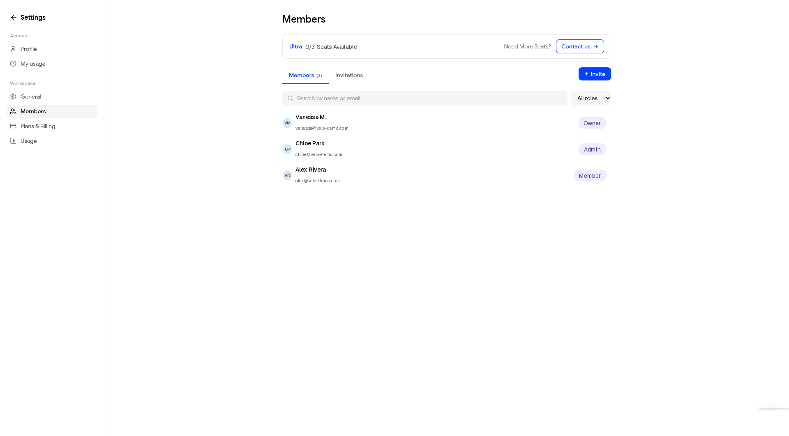

**Plans:** Free, Pro, Ultra · **Role:** Admin, Owner (to invite and manage) · **Uses credits:** No

Invite your team, give each person the right role, and share one workspace's videos, Brand Kit and credits.

<Frame caption="The Members page, where you invite teammates and manage roles.">
  
</Frame>

## Invite a teammate

1. Open the workspace menu, then select **Settings**.
2. Under **Workspace**, select **Members**.
3. Select **Invite**.
4. Enter their email and choose a role.
5. Send the invite.

Invites expire after **7** days. If your plan's seats are all taken, the invite fails with **seat limit reached**.

## What each role can do

| Action | Owner | Admin | Member |
| --- | --- | --- | --- |
| Make videos, libraries and assets | Yes | Yes | Yes |
| See credits and usage | Yes | Yes | Yes |
| Leave the workspace | Yes | Yes | Yes |
| Invite, remove and change members' roles | Yes | Yes | No |
| Edit the Brand Kit | Yes | Yes | No |
| Turn on the Velo Public Library | Yes | Yes | No |
| Connect Slack | Yes | Yes | No |
| Change, cancel or reactivate the plan | Yes | No | No |
| Buy top-ups, see invoices, manage payment | Yes | No | No |
| Rename the workspace or change its logo | Yes | No | No |
| Delete the workspace | Yes | No | No |

- An admin can't remove another admin. Only the owner can.
- Nobody can be invited as owner.

## Ownership handover

If the last owner leaves or deletes their account, the admin who joined earliest becomes owner. With no admins, the member who joined earliest becomes owner.

## FAQs

**Why did my invite fail?**

Either all seats are taken, or the invite is more than **7** days old. Free a seat or upgrade, then send a new invite.

**How do I add more seats?**

Upgrade your plan. See [Plans and pricing](/plans-and-account/plans-and-pricing).

**Can I make someone else the owner?**

  Ownership passes on automatically when the last owner leaves.

## Recommended reading

- [Brand Kit](/organize/brand-kit): Set up your brand for everyone.
- [Share clones with your workspace](/voices-and-avatars/share-clones-with-your-workspace): Give your team one presenter.
- [Libraries](/organize/libraries): Organize shared videos.
